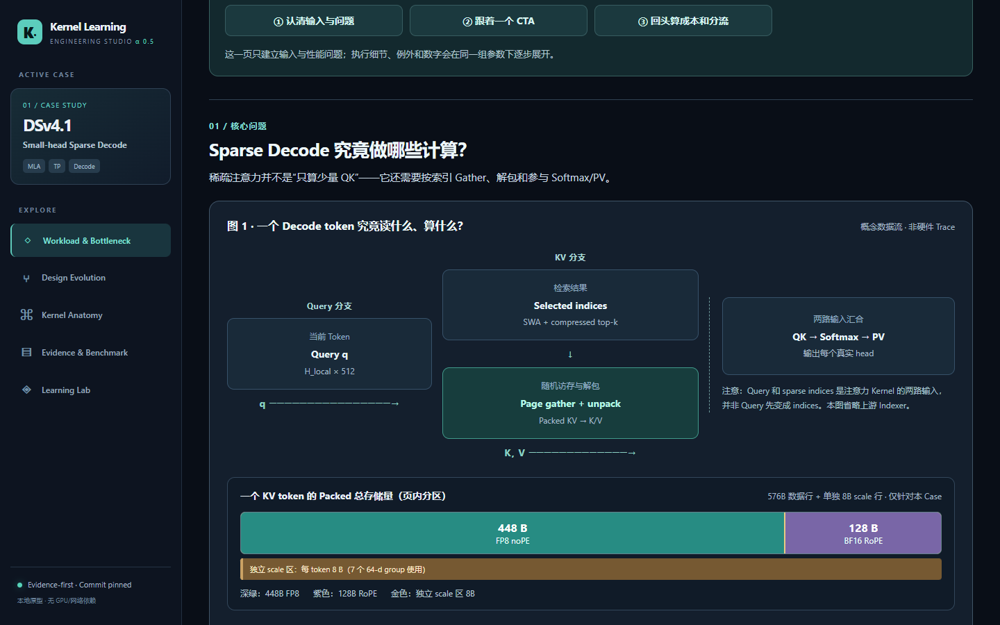

# Kernel Learning Agent

把推理 Kernel 变成可核查、可交互的工程学习案例：**为什么需要它、工作怎样映射到硬件、适用边界在哪里、怎样验证结论**。

*Evidence-first, source-pinned, interactive case studies for inference kernels.*

> **当前阶段：单案例教学原型。** 已有一个 DeepSeek V4.1 small-head sparse decode 页面、Case 数据、成本模型、源码映射和测试。页面中的 CTA 图是概念推导；本项目尚无 GPU 实测，也尚未实现“填入任意 Kernel 即自动生成页面”的通用生成器。



## 先看什么

| 入口 | 用途 |
| --- | --- |
| [首个 Case](cases/dsv41-small-head-decode/case.json) | 固定 workload、两条实现路线、来源与教学顺序 |
| [本地运行](#本地运行) | 打开交互页面、导出离线 HTML |
| [请求一个页面](https://github.com/ZhouMaomaoZhou/Kernel_Learning_Agent/issues/new?template=01-page-request.yml) | 提出你想研究的 Kernel；只提供问题也可以 |
| [贡献指南](CONTRIBUTING.md) | 提交证据、纠错、页面与 PR 的方式 |
| [社区路线图](docs/community-roadmap.md) | 多页面架构、CI、规模化审核计划 |

## 首个案例

**DeepSeek V4.1 small-head sparse decode** 研究两个有相近问题、却不可直接横比的实现：

| 实现 | 固定版本 | 本案例关注点 |
| --- | --- | --- |
| [vLLM PR #59418](https://github.com/vllm-project/vllm/pull/59418) | `74c0f0e10ac647ee22cf9e2bcd0ee20e40aee343` | SM90，16-head 计算 Tile、Key split、partial/merge 与 fallback |
| [SGLang PR #39674](https://github.com/sgl-project/sglang/pull/39674) | `b98a4ead5bd337418e8eb5a18e9f5f5a402baac0` | SM100/103，MMA Head-N 映射、64-key Tile、两次 PV 与 merge |

默认例子是 T=4、H=16、SWA=128、Extra=512。页面先定义 selected key 与 32-key block，再推导 20 blocks、16 splits、每个 split 至多 2 blocks；跟踪一个非空 CTA 至第二个 Merge Kernel，最后检查空 split、读取/计算成本及 dispatch。所有演示以固定源码快照为边界，**PR 作者的测量只标作 reported，未标作本项目复测**。研究出处和不能跨硬件比较的原因见[Case 证据索引](cases/dsv41-small-head-decode/evidence/README.md)；旧版教学设计记录见[项目历史](docs/project-history.md)。

## 本地运行

需要 Python 3.11+。构建、验证和本地服务使用标准库；打开离线页面不需要 GPU。

```powershell
git clone git@github.com:ZhouMaomaoZhou/Kernel_Learning_Agent.git
cd Kernel_Learning_Agent
python -m kernel_learning validate
python -m kernel_learning build
python -m kernel_learning serve
```

服务地址是 `http://127.0.0.1:8765`。也可直接打开构建得到的根目录 `Kernel_Learning_Studio.html`。更改源码或 Case 后重新运行 `build`；`python -m kernel_learning build --check` 校验本机离线入口是否与源码一致。

`python -m kernel_learning export-html --output <path>` 可导出单文件页面。默认**不**嵌入 `web/local-sources.json` 中导入的本地源码；`--include-local-sources` 仅供明确审阅后使用。页面 URL 的 `#` 部分记录方案、参数和所选 CTA，刷新及前进/后退可恢复学习位置。

完整测试需要浏览器依赖：

```powershell
python -m pip install -r requirements-dev.txt
python -m playwright install chromium
python -m unittest discover -s tests -v
```

本机已安装 Edge 时，可设 `KLA_BROWSER_CHANNEL=msedge` 来运行浏览器测试。CI 运行 Case 合同、Python/浏览器公式一致性、页面交互和构建检查；GPU 数值与性能实验留在明确标记的实验记录中，不能用概念动画替代。测试分层见[case-testing.md](docs/case-testing.md)。

## 一起制作页面

可以从一个**值得回答的工程问题**开始，不要求先写完整 HTML，也不要求有 GPU。请通过[页面请求表单](https://github.com/ZhouMaomaoZhou/Kernel_Learning_Agent/issues/new?template=01-page-request.yml)写明模型/算子、输入场景、想解释的瓶颈、已知源码或 PR 链接，以及希望别人帮忙的部分。维护者和贡献者可在 Issue 中认领来源核查、成本模型、可视化、测试或审稿。

已有材料时，先在 Issue 中定 `case_id` 和版本边界，再开 **Draft PR**。PR 应明确提出需要评审者回答的具体问题，例如“这段 wrapper 在 T=8 时是否进入 fast path？请看固定 SHA 的哪些行”，并给出当前证据等级。不要以一张没有 Case、来源和测试的独立 HTML 作为完成品。具体步骤见[CONTRIBUTING.md](CONTRIBUTING.md)及自动出现的 [PR 模板](.github/pull_request_template.md)。

**当前限制：** `web/`、CLI 和默认测试仍围绕第一个 Case 编写。第二个案例会先作为一次真实的架构验证，随后再抽取多页面构建、目录索引和按 Case 分组的 CI；路线与验收标准见[社区路线图](docs/community-roadmap.md)。

## 仓库文件

| 路径 | 作用 |
| --- | --- |
| `cases/<case_id>/` | Case JSON、成本与来源分析、证据和实验记录；研究事实的主要归属地 |
| `cases/schema.json` | 当前 Case 数据结构；新增策略要同步更新并测试 |
| `web/` | 现有案例的页面源码、样式、JS 和固定源码摘录 |
| `kernel_learning/` | 标准库 CLI、Case 验证、派生模型与离线构建 |
| `tests/` | 通用合同、首个 Case 样例、浏览器交互 |
| `skills/` | Intake → History → Model → Explain → Investigate 的研究/讲解流程 |
| `docs/` | 教学规范、研究记录、协作与演进计划 |
| `references/` | 原始 Obsidian Canvas；保留来源，不静默改写 |
| `.github/` | CI、页面请求表单与 PR 模板 |

`Kernel_Learning_Studio.html` 是可重建的本地 Obsidian 入口，`web/local-sources.json` 可能含本地源码；两者都不进入 Git。页面发布和统一目录尚未启用。

## 许可证与来源

项目原创代码和文档采用 [Apache-2.0](LICENSE)。固定源码摘录分别来自 [vLLM](https://github.com/vllm-project/vllm/blob/74c0f0e10ac647ee22cf9e2bcd0ee20e40aee343/LICENSE) 与 [SGLang](https://github.com/sgl-project/sglang/blob/b98a4ead5bd337418e8eb5a18e9f5f5a402baac0/LICENSE) 的对应版本；出处见 [THIRD_PARTY_NOTICES.md](THIRD_PARTY_NOTICES.md)。引用和测量请保留原始来源、SHA、运行环境及 `reported`/`reproduced` 区别。
